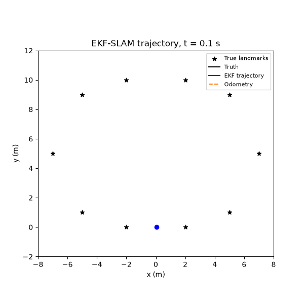
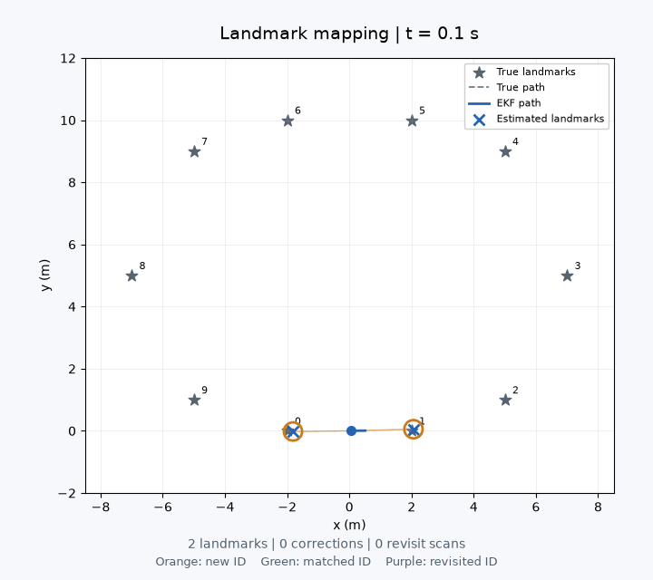

# 2D EKF-SLAM Simulation

A Python implementation of landmark-based Simultaneous Localization and Mapping for a differential-drive robot. An Extended Kalman Filter jointly estimates the robot pose and an initially unknown landmark map from noisy wheel travel and range–bearing measurements.

Includes six simulation scenarios, paired Monte Carlo experiments, an offline interactive replay, and a Gazebo Classic / ROS 2 demonstration.

## Simulation demos

### Trajectory estimation

Ground truth, noisy wheel odometry, and the EKF estimate over two circular passes. Repeated landmark observations constrain accumulated odometry drift.



### Landmark mapping and loop closure

The estimated map grows as landmarks are first observed. Colored rings show new IDs in orange, repeated matches in green, and landmarks recognized after at least 10 seconds without an observation in purple. Revisit frames pause briefly for readability.



Both animations use the recorded baseline experiment with seed 7. Landmark identities are supplied by the synthetic sensor; coordinates are estimated by the filter.

## Features

- Explicit EKF prediction, range–bearing correction, and correlated landmark initialization.
- Full robot–landmark covariance, wrapped angle innovations, and Joseph-form covariance updates.
- Baseline, high sensor noise, high odometry noise, sensor dropout, no landmark reuse, and underestimated noise scenarios.
- Recorded measurements, map histories, and landmark revisit diagnostics in an offline HTML guide.
- Gazebo differential-drive simulation with encoder-mode odometry and RViz visualization.

## Quick start

Python 3.10 or newer is required. Gazebo is optional for the independent simulation.

```bash
git clone https://github.com/rivindu02/ekf-slam-simulation.git
cd ekf-slam-simulation
python3 -m venv .venv
.venv/bin/python -m pip install -r requirements.txt
.venv/bin/python -m unittest discover -s tests -v
.venv/bin/python scripts/run_experiments.py --trials 20 --animate
```

Open [PROJECT_GUIDE.html](PROJECT_GUIDE.html) locally in a browser for the interactive replay, equations, source walkthrough, and recorded results. Use **Next loop closure** to jump to returning landmark IDs and inspect their pose corrections.

The guide is self-contained and works offline. `requirements.txt` provides dependency ranges; `requirements-lock.txt` records the Python 3.14 environment used for the included results.

## Results

Baseline results across 20 paired seeds, reported as mean ± sample standard deviation:

| Metric | Result |
|---|---:|
| EKF trajectory position RMSE | 0.238 ± 0.146 m |
| Odometry trajectory position RMSE | 3.233 ± 1.172 m |
| Final landmark map RMSE | 0.207 ± 0.182 m |

The experiment set contains 120 runs across six scenarios. Per-run metrics are in [results/metrics.csv](results/metrics.csv), and aggregate statistics and configurations are in [results/summary.json](results/summary.json). The animations show one recorded trial, rather than the trial averages.

The model uses ten static point landmarks, known IDs, a known starting pose, and a 360-degree sensor with a 4.5 m range. It does not implement visual recognition, LiDAR feature extraction, occlusion, or unknown data association. Sensor outages can leave map distortion even after the robot position recovers. The no-reuse scenario deliberately disables all repeated landmark corrections.

## Gazebo and ROS 2

With Gazebo Classic 11, ROS 2 Humble, `gazebo_ros`, `gazebo_plugins`, and NumPy installed, run from the project root:

```bash
bash gazebo/run_demo.sh gui 105
```

This opens Gazebo and RViz. Use `headless` for a run without windows, or use duration `0` to run until Ctrl+C. The duration is measured in simulated seconds.

The demo uses encoder-mode odometry and synthetic landmark measurements. A separate simulator-pose controller follows the demonstration route; simulator pose is not used as an EKF correction. See [docs/GAZEBO.md](docs/GAZEBO.md) for setup, topics, controls, and outputs.

## Reproduce the figures and guide

After generating the experiment recordings:

```bash
.venv/bin/python scripts/render_mapping_gif.py
.venv/bin/python scripts/build_guide.py
node scripts/validate_guide_replay.cjs
```

Node.js is only needed for the optional replay logic check. The Python suite contains 11 tests; the replay check covers 1,266 frames across six scenarios. It validates rendering coordinates and controls without testing browser layout.

## Project layout

| Path | Contents |
|---|---|
| [src/](src/) | EKF implementation, independent simulation, and demo controller |
| [tests/](tests/) | Numerical, controller, loop-closure, and recording checks |
| [gazebo/](gazebo/) | World, ROS adapter, launcher, and RViz configuration |
| [scripts/](scripts/) | Experiment runners, visualization, and document builders |
| [results/](results/) | Recorded arrays, metrics, figures, and GIFs |
| [docs/](docs/) | Gazebo instructions, presentation outline, and project notes |
| [report/](report/) | Markdown, PDF, editable DOCX, and presentation |

## Report and submission

Read the [report PDF](report/EKF_SLAM_Report.pdf) or its [Markdown source](report/report.md) for methodology and analysis. Rebuild the documents and portable submission archive with:

```bash
.venv/bin/python scripts/build_report.py
.venv/bin/python scripts/build_presentation.py
.venv/bin/python scripts/package_submission.py
```

Document builders overwrite their generated outputs. The submission ZIP excludes environments, Git metadata, caches, and runtime logs, and is not tracked in Git.
