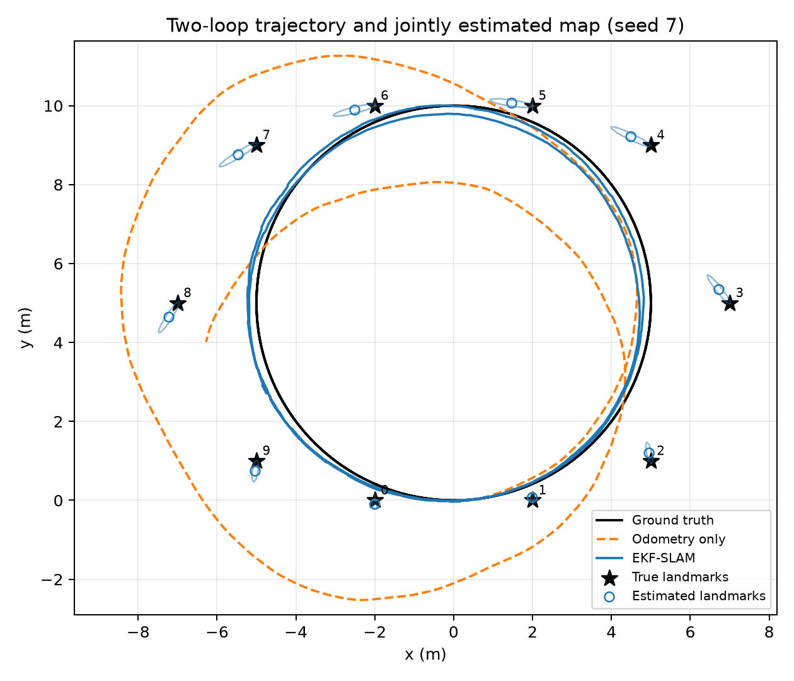
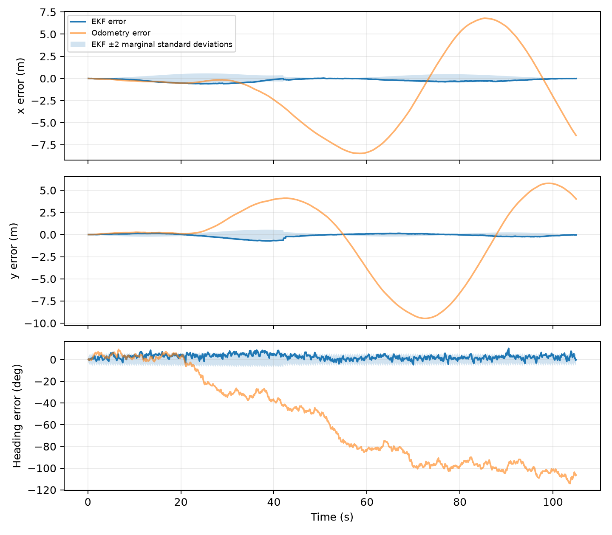
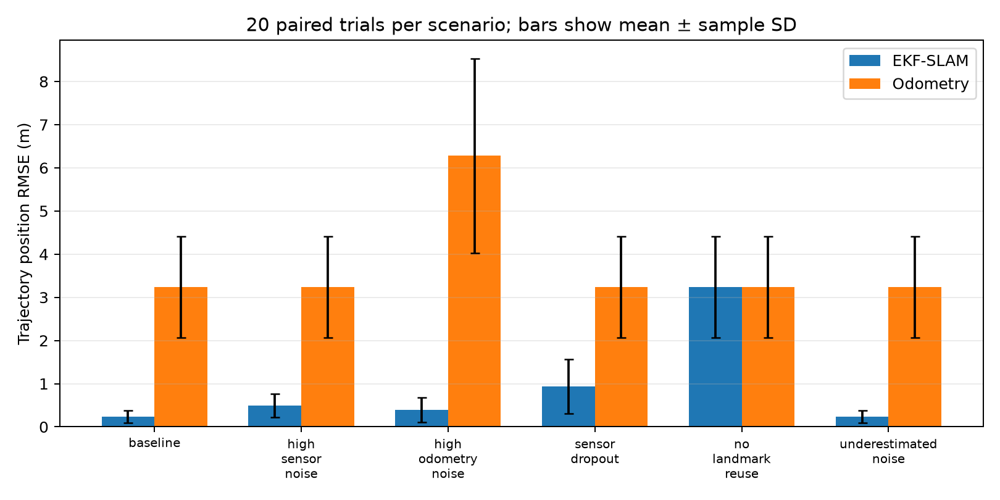
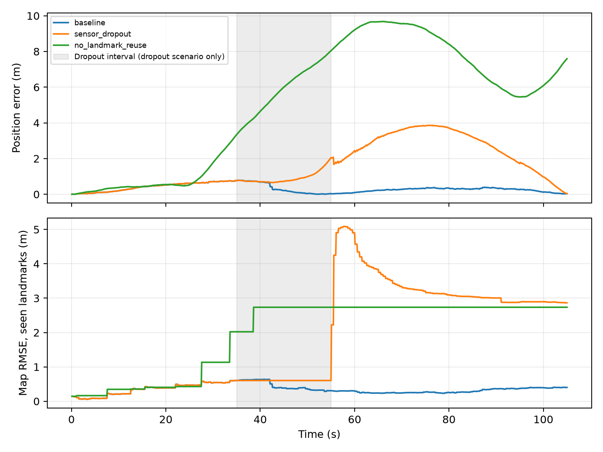
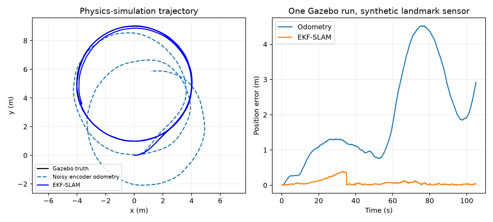

# EKF-Based 2D SLAM for a Differential-Drive Robot Using Range–Bearing Landmark Measurements

Mini Project: Implementing State Estimation Filters

Student name: Kumarage R.V.

Registration number: 220343B

Module / lecturer: EN4594 Autonomous Systems


## Abstract

This project implements an Extended Kalman Filter (EKF) that jointly estimates the planar pose of a differential-drive robot and the locations of initially unknown point landmarks. Noisy left/right wheel travel provides prediction inputs; noisy range and bearing observations provide corrections. The estimator maintains the full joint covariance, including correlations between the robot and landmarks. A self-contained Python simulation follows approximately two circular loops among ten landmarks. Six scenarios are evaluated using 20 paired random seeds each. In the baseline experiment, mean trajectory position RMSE decreases from 3.233 m for odometry alone to 0.238 m for EKF-SLAM, a 92.6% reduction in the mean RMSE. A separate Gazebo Classic 11 / ROS 2 Humble demonstration uses a physical differential-drive model and a synthetic landmark sensor. Results show the value of landmark reuse, the effects of sensor outages, and the difference between estimation accuracy and uncertainty calibration. The study assumes known landmark identities and does not implement visual detection, LiDAR feature extraction, or unknown data association.

## 1. Introduction

A mobile robot needs both its location and a representation of its environment to navigate. Wheel odometry estimates motion by integrating wheel travel, but small errors accumulate. Localization assumes that a map already exists. Simultaneous Localization and Mapping (SLAM) instead estimates the robot pose and the map together [1]. This project addresses landmark-based 2D SLAM, a different application from localization against a known map.

The objective is to implement the EKF equations explicitly, demonstrate that map coordinates are learned from observations, compare the estimate with odometry alone, and investigate conditions that degrade performance. Python is used because the assignment permits a preferred implementation platform. NumPy supplies matrix operations; the EKF is implemented in project code rather than delegated to a SLAM package. Matplotlib generates plots and an animation. Gazebo and ROS provide an additional demonstration; the main statistical results come from the independent simulator.

## 2. Scope and assumptions

The robot has planar pose (x, y, theta), the landmarks are stationary points, and left/right wheel displacement errors are modeled as independent zero-mean Gaussian samples. The initial pose is fixed at the origin with heading zero, which anchors the map coordinate frame. The initial covariance is a small numerical value, 1e-10 times the 3-by-3 identity. Landmark coordinates are not supplied to the estimator.

The sensor reports landmark identity, range, and bearing. Known identities remove the data-association problem while leaving the mapping and localization problem intact. Sensor visibility is a full 360 degrees within 4.5 m, without occlusion. The sensor is collocated with the robot reference point. Noise is independent between observations and wheel samples. The simulations contain no false detections, moving landmarks, wheel bias, or deliberate outliers. These are simplifying assumptions, not properties of a general real-world robot.

## 3. Mathematical methodology

### 3.1 Joint state and uncertainty

The full state contains robot pose followed by each discovered landmark's Cartesian coordinates:

```text
X = [x, y, theta, m1x, m1y, ..., mNx, mNy]^T
P = E[(X - X_hat)(X - X_hat)^T]
```

The state grows by two elements per new landmark. With ten landmarks it has 23 elements. Cross-covariance blocks represent shared uncertainty: a landmark first observed from an uncertain pose inherits uncertainty correlated with the robot and previously mapped landmarks. Ignoring those blocks would change the estimator and can make its confidence misleading.

### 3.2 Differential-drive prediction

Let b be wheel separation, and dL and dR be left/right travel over one sample. The midpoint approximation is:

```text
d = (dL + dR)/2
phi = (dR - dL)/b
a = theta + phi/2
x_next = x + d*cos(a)
y_next = y + d*sin(a)
theta_next = wrap(theta + phi)
```

Angles are wrapped to [-pi, pi). Landmark means remain unchanged during prediction because the environment is static. The midpoint model approximates curved motion over a short interval; it is not an exact circular-arc integrator. The independent simulation uses the same kinematic model for truth and prediction, which removes one source of model mismatch and makes its results optimistic relative to real hardware.

The robot-pose Jacobian G and the control Jacobian V are:

```text
G = [[1, 0, -d*sin(a)],
     [0, 1,  d*cos(a)],
     [0, 0,          1]]

V = [[cos(a)/2+d*sin(a)/(2*b), cos(a)/2-d*sin(a)/(2*b)],
     [sin(a)/2-d*cos(a)/(2*b), sin(a)/2+d*cos(a)/(2*b)],
     [-1/b,                   1/b]]
```

F is the full-state identity with G in its top-left block. With wheel-travel covariance Qw, prediction is:

```text
X_minus = f(X_plus, [dL, dR])
P_minus = F*P_plus*F^T
P_minus[robot, robot] += V*Qw*V^T
Qw = diag(sigma_wheel^2, sigma_wheel^2)
```

Wheel noise is expressed in metres per sample, rather than metres per second. This distinction matters when changing the sample period. Independent wheel errors generate correlated position/heading uncertainty through V.

### 3.3 Range–bearing measurement model

For landmark j, define dx = mjx - x, dy = mjy - y, q = dx squared plus dy squared, and r = sqrt(q). The expected observation is:

```text
h_j(X) = [r, wrap(atan2(dy, dx) - theta)]^T
R = diag(sigma_range^2, sigma_bearing^2)
```

The nonzero Jacobian blocks for robot pose and landmark j are:

```text
H_robot = [[-dx/r, -dy/r,  0],
           [ dy/q, -dx/q, -1]]
H_landmark = [[ dx/r,  dy/r],
              [-dy/q,  dx/q]]
```

All other columns are zero. A landmark exactly at the sensor origin has undefined bearing, so the implementation rejects a degenerate predicted range. The bearing innovation is wrapped to avoid a false residual close to two pi at the angle discontinuity.

### 3.4 Initializing a new landmark

For a first observation z = [r, beta], let alpha = theta + beta. The inverse observation model gives:

```text
m_new = [x + r*cos(alpha), y + r*sin(alpha)]^T
A_robot = [[1, 0, -r*sin(alpha)],
           [0, 1,  r*cos(alpha)]]
B = [[cos(alpha), -r*sin(alpha)],
     [sin(alpha),  r*cos(alpha)]]
```

A is the 2-by-current-state-size Jacobian with A_robot in the first three columns and zeros elsewhere. The augmented covariance is:

```text
P_new = [[P,       P*A^T],
         [A*P, A*P*A^T + B*R*B^T]]
```

This preserves the correlations needed for SLAM. A newly initialized observation is not immediately reused as a correction, which would count the same information twice. Initializing an unknown landmark does not independently correct robot pose; repeated observations are needed to constrain accumulated drift.

### 3.5 Correcting an existing landmark

Observations are processed sequentially. The measurement model is relinearized after every correction. For innovation nu and innovation covariance S:

```text
nu = z - h(X_minus); nu[bearing] = wrap(nu[bearing])
S = H*P_minus*H^T + R
K = P_minus*H^T*S^(-1)
X_plus = X_minus + K*nu
P_plus = (I-K*H)*P_minus*(I-K*H)^T + K*R*K^T
```

The code computes K using a linear solve rather than a matrix inverse. The Joseph covariance update reduces numerical loss of symmetry or positive semidefiniteness. Covariance is explicitly symmetrized after prediction and correction. The robot heading is wrapped after mean updates.

### 3.6 Evaluation metrics

```text
Position RMSE = sqrt(mean((x_hat-x_true)^2 + (y_hat-y_true)^2))
Heading RMSE = sqrt(mean(wrap(theta_hat-theta_true)^2))
Map RMSE = sqrt(mean_j(||m_hat_j-m_true_j||^2))
NIS = nu^T*S^(-1)*nu
```

Map RMSE uses the landmark IDs present in the estimated map. Final map RMSE compares all discovered landmarks at the final sample. No trajectory alignment is applied because the initial pose defines a shared coordinate frame. Reported mean and sample standard deviation summarize per-run metrics across seeds, not samples pooled into a single RMSE. The error bars are standard deviations, not confidence intervals.

For a correctly modeled two-component innovation, an NIS mean near two is a useful diagnostic. It is not proof that the full SLAM covariance is statistically consistent. Linearization, correlated updates, nonlinear trajectories, and finite samples complicate interpretation. Standard EKF-SLAM can become overconfident [2].

## 4. Implementation and reproducibility

The estimator is in src/ekf_slam.py. It exposes motion, observation, prediction, initialization, and correction functions. It accepts only wheel increments and identity/range/bearing observations. The truth map lives in src/simulation.py and is used by the simulated sensor and evaluation code. This interface prevents the estimator from using true landmark coordinates for its updates.

The experiment runner writes one CSV row per scenario and seed, a JSON summary, compressed arrays for the seed-7 illustrations, four plot sets in PNG/PDF formats, and an animated trajectory GIF. Separate random-number streams for wheel and sensor noise keep disturbances comparable across scenarios. Seeds 0 through 19 are used for quantitative results; seed 7 is used for figures and is not selected for unusually favorable performance.

```text
python -m venv .venv
.venv/bin/python -m pip install -r requirements.txt
.venv/bin/python -m unittest discover -s tests -v
.venv/bin/python scripts/run_experiments.py --trials 20 --animate
.venv/bin/python scripts/build_report.py
```

The submitted requirements-lock.txt records versions from the validated host environment. It may need adjustment for a different Python version. Gazebo uses the container's ROS Python and does not require the report-generation dependencies.

## 5. Experimental design

The baseline runs for 105 s at dt = 0.1 s, with forward speed 0.6 m/s and yaw rate 0.12 rad/s. Wheel separation is 0.4 m. This produces approximately two loops with radius 5 m. Ten landmarks are arranged around the route, and observations occur every fifth motion step, approximately 2 Hz. Wheel travel standard deviation is 0.006 m/sample; range standard deviation is 0.1 m; bearing standard deviation is 0.02 rad (about 1.15 degrees).

The six scenarios are:

- Baseline: matched process and sensor noise models with landmark reuse.
- High sensor noise: range and bearing standard deviations are tripled; R is updated to match.
- High odometry noise: wheel-travel standard deviation is doubled; Qw is updated to match.
- Sensor dropout: no landmark observations are supplied from 35 to 55 s, while prediction continues.
- No landmark reuse: first observations initialize landmarks, but all subsequent observations are ignored.
- Underestimated noise: actual noise remains baseline, but all assumed standard deviations are scaled to 0.35 of their true values.

The no-reuse scenario removes every repeated-landmark correction, including nearby repeated observations. It is not an experiment that removes only the final loop closure. Its purpose is to isolate the need for measurement reuse in this particular estimator.

## 6. Results

Table 1 reports mean ± sample standard deviation across 20 trials per scenario. Every numeric result in this section is generated from results/summary.json and results/metrics.csv.

| Scenario | EKF position RMSE (m) | Odometry RMSE (m) | Final map RMSE (m) |
|---|---:|---:|---:|
| baseline | 0.238 ± 0.146 | 3.233 ± 1.172 | 0.207 ± 0.182 |
| high sensor noise | 0.490 ± 0.268 | 3.233 ± 1.172 | 0.466 ± 0.299 |
| high odometry noise | 0.390 ± 0.288 | 6.277 ± 2.249 | 0.411 ± 0.358 |
| sensor dropout | 0.938 ± 0.624 | 3.233 ± 1.172 | 1.146 ± 1.003 |
| no landmark reuse | 3.233 ± 1.172 | 3.233 ± 1.172 | 2.136 ± 0.884 |
| underestimated noise | 0.238 ± 0.146 | 3.233 ± 1.172 | 0.207 ± 0.182 |



### 6.1 Baseline performance

Baseline mean position RMSE is 0.238 m, compared with 3.233 m for odometry, a 92.6% reduction in the ratio of mean RMSE values. Mean heading RMSE is 2.793 degrees. Mean final robot position error is 0.033 m, while mean final map RMSE is 0.207 m. A small final position error does not imply that the entire map is equally accurate: correlations and earlier linearization errors affect the landmark estimates.



### 6.2 Noise sensitivity

Tripling sensor noise raises mean trajectory RMSE to 0.490 m. Doubling wheel noise raises it to 0.390 m. The filter still improves on the corresponding odometry baseline in mean RMSE, but neither experiment establishes robustness to systematic bias, outliers, or incorrect landmark associations. Large trial-to-trial map variation also cautions against reporting a single favorable trajectory as a general result.



### 6.3 Dropout and repeated observations

During the 20 s sensor outage, the filter can only propagate its motion model and uncertainty. Mean trajectory RMSE increases to 0.938 m, and mean final map RMSE increases to 1.146 m. Later observations improve final robot position, but they do not reliably remove all map distortion. In seed 7, final map RMSE remains 2.865 m despite a final robot position error of 0.046 m. This is an observed limitation of the tested EKF configuration, not a claim of perfect loop-closure recovery.

Without landmark reuse, trajectory RMSE is identical to odometry. This follows directly from the algorithm: new landmark augmentation adds map states without changing the robot mean, and there are no correction steps. Repeated observations, rather than merely drawing a map from first sightings, provide the localization benefit.



### 6.4 Accuracy versus confidence

Underestimating all noise standard deviations by the same factor leaves the mean trajectory almost unchanged: the baseline and underestimated-noise mean RMSE values both round to 0.238 m. However, mean NIS increases from 2.02 to 16.50. Approximately scaling both Q and R together scales the propagated covariance while preserving much of the gain ratio. Consequently, similar state estimates can coexist with severely overconfident reported uncertainty. This experiment does not investigate the separate effect of changing only Q or only R.

## 7. Gazebo Classic / ROS 2 demonstration

The available development container was inspected and contains Gazebo Classic 11.10.2 and ROS 2 Humble. A self-contained SDF world includes a ground plane, differential-drive robot, two driven wheels, low-friction support casters, ten static landmark posts, and lighting. No external model download is required. The ROS differential-drive plugin is configured for encoder-mode odometry rather than world-pose odometry [3]. A state plugin publishes model poses for sensor synthesis and evaluation [4].

The adapter in gazebo/slam_node.py reconstructs wheel travel from encoder odometry twist and sample duration, adds Gaussian wheel-travel noise, and sends the resulting increments to the same EKF implementation. A synthetic range–bearing sensor uses Gazebo poses to generate noisy observations. True map coordinates remain outside the EKF. A separate pure-pursuit controller uses simulator pose to follow a radius-4 m circle centred at (0, 5), with a stop within 0.8 m of a landmark centre. This is demonstration navigation, not an estimated-pose navigation result or a general obstacle-avoidance planner. This is simulator-assisted sensor generation, not actual landmark detection from an onboard camera or LiDAR. ROS callbacks are asynchronous, so small timing differences and physics errors make this a separate experiment from the kinematic Monte Carlo study.

The node publishes an estimated path, ID labels, live detection rays, map counters, and estimated-landmark markers for RViz inspection. The GUI launcher opens a configured RViz view alongside Gazebo. It also logs visible IDs and update counts. The node writes separate Gazebo CSV/JSON output. The launcher uses ROS domain 74 and Gazebo master port 11355 by default to reduce interference with other sessions. Run instructions are in docs/GAZEBO.md. Quantitative Gazebo validation status is recorded below when a completed run is available.

A completed headless Gazebo run lasted 27.4 simulated seconds and recorded 274 odometry updates. It mapped 8 landmarks. Trajectory RMSE was 0.114 m for EKF-SLAM and 0.823 m for noisy encoder odometry. Final map RMSE was 0.171 m. This is one physics-simulation run, not a Monte Carlo result. A separate short GUI/RViz smoke run also completed without display initialization errors.



The minimum measured robot-to-post centre distance was 0.966 m, above the 0.45 m conservative combined footprint. The run processed 145 observations and 137 EKF corrections.

## 8. Verification

Eleven automated tests verify the motion Jacobians against finite differences, the observation Jacobian against finite differences, covariance augmentation and nonzero robot/map correlation, wrapped bearing innovations, zero-noise trajectory agreement, and reproducibility plus baseline improvement. Two of these tests check full-route clearance/landmark coverage and the near-obstacle safety stop under kinematic motion. Three additional tests verify recorded map and measurement histories, successful landmark reuse and drift correction on loop closure, and the absence of corrections in the no-reuse scenario. The augmentation test also verifies that a new observation is not double-counted. Covariance symmetry and minimum eigenvalue are checked in relevant numerical tests; each Monte Carlo run also records its final minimum covariance eigenvalue.

These checks validate important algebraic and numerical properties. They do not prove correct operation for arbitrary environments, establish full statistical consistency, or replace a real sensor experiment. The actual test output is included in results/validation.txt.

## 9. Discussion and limitations

The results support three conclusions within the stated assumptions. First, joint estimation and repeated landmark observations substantially reduce odometry drift. Second, larger noise and sensor outages degrade mapping and localization even when final robot position looks accurate. Third, uncertainty calibration must be assessed separately from the accuracy of the mean estimate.

The most significant limitation is known data association. A wrong ID can create a confident but incorrect correction. Practical extensions could add innovation gating and a carefully evaluated association method, but those extensions are outside the submitted implementation. The circular route, ten landmarks, Gaussian noise, short horizon, and exactly matched kinematic truth model also limit generality. The physical robot demonstration introduces dynamics, but its landmark sensing still uses simulated truth and omits occlusion.

An EKF uses a local first-order approximation. Large heading errors during the dropout can invalidate that approximation and leave distorted maps; this agrees with established concerns about EKF-SLAM consistency [2]. Dense joint covariance storage grows quadratically with landmark count. The supplied Joseph update uses dense matrix operations, so it is suitable for a small educational map rather than a large production SLAM system. No global optimality or large-scale reliability is claimed.

Useful future work includes testing biased odometry and outliers, comparing separate Q/R tuning changes, extracting landmarks from a real simulated sensor, evaluating statistical coverage over more trajectories, and comparing with a graph-based method. Those are proposed extensions, not completed features.

## 10. Conclusion

A working landmark-based EKF-SLAM implementation was developed with explicit differential-drive prediction, nonlinear range–bearing correction, and correlated landmark initialization. Across 20 baseline trials, mean trajectory position RMSE decreased from 3.233 m to 0.238 m. The experiments also exposed limitations: dropout can leave substantial map distortion, and uniform covariance underestimation can leave accuracy unchanged while making confidence unrealistic. The provided code, data, plots, report-generation scripts, and optional Gazebo demonstration allow the work to be reproduced and examined.

## References

[1] H. Durrant-Whyte and T. Bailey, “Simultaneous Localisation and Mapping (SLAM): Part I — The Essential Algorithms,” IEEE Robotics & Automation Magazine, 2006. Author-hosted publication page: https://www-personal.acfr.usyd.edu.au/tbailey/publications/slamtutorial1.htm

[2] T. Bailey, J. Nieto, J. Guivant, M. Stevens, and E. Nebot, “Consistency of the EKF-SLAM Algorithm,” IEEE/RSJ International Conference on Intelligent Robots and Systems, 2006. Author-hosted paper: https://www-personal.acfr.usyd.edu.au/tbailey/papers/ekfslam.pdf

[3] Open Source Robotics Foundation and contributors, gazebo_ros_diff_drive.cpp, ROS 2 branch of gazebo_ros_pkgs. Source: https://github.com/ros-simulation/gazebo_ros_pkgs/blob/ros2/gazebo_plugins/src/gazebo_ros_diff_drive.cpp

[4] Open Source Robotics Foundation and contributors, gazebo_ros_state.cpp, ROS 2 branch of gazebo_ros_pkgs. Source: https://github.com/ros-simulation/gazebo_ros_pkgs/blob/ros2/gazebo_ros/src/gazebo_ros_state.cpp

[5] Course assignment, “Mini Project: Implementing State Estimation Filters,” supplied locally as MiniProject_FilterImplementation2.pdf.

## Appendix A. Code explanation and selected snippets

The following excerpt shows the correction structure; the full implementation, including all model and initialization equations, is supplied in src/ekf_slam.py.

```python
predicted, H = observation(self.x, self.ids[identity])
innovation = np.asarray(z) - predicted
innovation[1] = wrap(innovation[1])
S = H @ self.P @ H.T + self.R
K = np.linalg.solve(S, H @ self.P).T
self.x += K @ innovation
self.x[2] = wrap(self.x[2])
A = np.eye(len(self.x)) - K @ H
self.P = A @ self.P @ A.T + K @ self.R @ K.T
self.P = (self.P + self.P.T) / 2
```

motion() computes the predicted pose and analytic Jacobians. observation() constructs a two-row Jacobian in the full state space. initialize() adds a landmark with correlated uncertainty. predict() propagates the whole covariance. correct() initializes unseen IDs or updates already mapped IDs. simulation.run() owns truth, odometry, observation generation, and scoring. scripts/run_experiments.py runs all trials and renders figures. gazebo/slam_node.py adapts simulator messages to the same estimator interface.

## Appendix B. Submission contents

The report is supplied as PDF, editable DOCX, and Markdown. The project also includes source code, tests, experiment scripts, raw per-run metrics, plotted figures, a GIF demonstration, Gazebo world and launcher, a short presentation, and viva notes. Personal cover-page fields must be completed by the student before submission. All results are simulated; no real-world measurements are represented as collected data.
